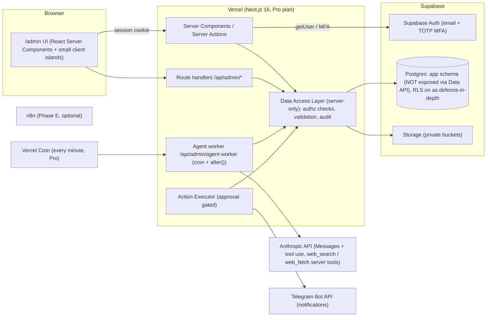

# 03 — System Architecture

Sources are listed at the end. Anything not verified against an official source is marked **NEEDS VALIDATION**.

## 1. Decision: extend the existing app, isolated (hybrid)

| Option | Pros | Cons | Verdict |
|---|---|---|---|
| **Extend the existing Next.js app**, with `/admin` under its own root layout and isolated modules | One repo, one deploy, one domain. Reuses the brand tokens and fonts. Cheapest. Fastest to build | Shares a deploy with the public site, so an admin bug could break a build. Same origin as the public site | **Recommended** |
| Separate admin app (second Next.js project, e.g. `admin.riseup-group.com`) | Hard isolation. Independent deploys and CSP | Second project, more setup. Vercel per-seat cost is unchanged, but there are two configs, a duplicated design system, and DNS work | Upgrade path, not needed now |
| Low-code admin (Retool, Appsmith, etc.) | Fast CRUD | Agent runtime and approvals still need custom code. Branding is weak. Cost per user | Rejected |

The **hybrid** sits between the two:
- Admin code lives in `src/admin/**` (domain logic, data access layer, agents) and `src/app/admin/**` (routes).
- It never imports public-site components, except the shared brand tokens and fonts.
- Splitting into a separate app later therefore means moving folders, not rewriting.

## 2. High-level diagram



## 3. Component decisions

| Concern | Recommendation | Alternatives considered | Reason |
|---|---|---|---|
| Frontend | Next.js 16 App Router, React Server Components first. Client components only for interactive islands (tables, command palette, charts) | SPA (Vite) | Already in the repo. RSC keeps data and secrets on the server |
| Admin UI libraries (new deps) | `@tanstack/react-table` (headless tables), `cmdk` (command palette), `recharts` **or** hand-written SVG charts (decide in Phase B; hand-rolled SVG matches the existing brand visuals), `zod` (validation) | shadcn/ui as a whole kit | Few, headless, brand-controllable dependencies |
| Backend | Server Actions for UI mutations, plus route handlers for the worker, cron and exports. **Every one calls the DAL, which re-checks auth and authorization.** Next.js docs say Server Actions are reachable by direct POST and must verify auth themselves | Separate API service | Fewer moving parts |
| Database | **Supabase Postgres.** Tables live in a dedicated `app` schema that is **not exposed** through Supabase's Data API (PostgREST). The server connects with a Postgres driver via the connection pooler | Neon + Auth.js; self-hosted Postgres | Managed Postgres, Auth with MFA, Storage and backups in one product. Hiding the schema removes the "RLS bypass from the browser" class of bugs entirely |
| ORM / migrations | **Drizzle ORM + drizzle-kit** (SQL-first, typed). Migrations reviewed as SQL and applied manually to staging first | Supabase CLI migrations only; Prisma | Typed queries, readable SQL, small runtime. NEEDS VALIDATION: Drizzle + Supabase pooler compatibility in serverless (transaction mode, `prepare: false`) |
| Authentication | **Supabase Auth**: email + password, **TOTP MFA required** for all human users. `@supabase/ssr` cookie sessions. Public sign-up **disabled**; users are invited only | Auth.js, Clerk | MFA with `aal2` levels is built in. Clerk adds per-user cost |
| Authorization | Role-based (`owner`, `team_member`) + permission strings, checked in the DAL on every call. RLS enabled on all tables as a second layer for any future Data API exposure | RLS-only | OWASP: deny by default, check on the server on every request |
| Background jobs / agent runtime | **Postgres-backed job queue** (`agent_runs` with leases, `FOR UPDATE SKIP LOCKED`). Runs are executed by a worker route handler, triggered (a) immediately via `after()` when enqueued and (b) by Vercel Cron every minute to pick up retries and stuck runs. Each invocation runs bounded steps and checkpoints | Inngest / Trigger.dev; n8n; Redis + BullMQ; Anthropic Managed Agents | No new infrastructure. Durable state already lives in the DB. Inngest is the upgrade path if volume grows (doc 09). Redis is unnecessary at this scale |
| LLM provider | **Anthropic API only** for MVP (`@anthropic-ai/sdk`, tool use + `web_search` / `web_fetch` server tools). Model configurable per agent | OpenAI, Gemini, multi-provider router | One provider means one key, one cost model and one set of safety behaviours. The `agents.model` and `provider` columns keep a second provider possible later without a rewrite |
| Realtime | **Polling** (3 s on run detail and the approvals badge, 30 s elsewhere) via route handlers | Supabase Realtime, SSE | Realtime would require exposing tables to the browser. Polling is enough for 2 users |
| File storage | Supabase Storage, **private** buckets. Server-generated short-lived signed URLs. Type and size allow-list | Vercel Blob | Same vendor and backups |
| Logging & monitoring | `audit_logs` + `agent_steps` tables (business audit). Vercel runtime logs. **Sentry free tier** for errors (NEEDS VALIDATION: free quota). A health page in Settings | Datadog | Cost |
| Notifications | In-app `notifications` table. Telegram bot messages for: approval waiting, agent failed, payment overdue. **Informational only, no action buttons** in the MVP | Email | The bot already exists |
| Deployment | Vercel **Pro** (commercial use), production branch as today. **Preview deployments must not have production DB credentials**; previews use a separate Supabase project with no real data | Cloudflare | Already on Vercel |
| Environments | `local` (Supabase local or staging), `staging` (Supabase project 2, demo data allowed, labelled), `production` | — | Keeps fake data out of production |
| Backups | Supabase daily backups (Pro), plus a weekly logical dump (`pg_dump`) to private storage outside Supabase, kept for 4 weeks. Restore test monthly | — | Doc 05 §6 |

## 4. Request lifecycle (human action)

1. The browser sends a request with the Supabase session cookie.
2. `proxy.ts` does an **optimistic** check only: no session cookie on `/admin/**` → redirect to `/admin/login`. Next.js docs say the proxy is not a full authorization solution.
3. The layout or page calls `requireUser({ aal: "aal2" })` in the DAL. This verifies the JWT with Supabase (`getUser` / claims verification), loads the role and permissions from `app.users`, and rejects disabled users and revoked sessions.
4. The Server Action validates input with zod and calls the DAL function. The DAL checks the permission, e.g. `crm.company.update`, executes in a transaction, and writes the `audit_logs` row in the **same transaction**.
5. The response returns a DTO with only the fields that role may see. Finance fields are stripped for `team_member` without `finance.read`.

## 5. Agent run lifecycle (summary; detail in doc 04)

`enqueue` (human or schedule) → `queued` → the worker claims a lease → `running` (steps loop: model call → tool calls via the **Tool Gateway** → checkpoint) → `waiting_approval` (if a gated action was proposed) → `succeeded` / `failed` / `timed_out` / `cancelled`.

## 6. Proposed folder layout (implementation, Phase 2)

```
src/app/admin/                 # second root layout (own <html>, noindex, strict CSP)
  layout.tsx, login/, (app)/overview, agents/, find-clients/, crm/…, approvals/, finance/, projects/, tasks/, knowledge/, settings/
src/app/api/admin/             # route handlers: agent-worker, cron, exports, health
src/admin/
  auth/        session.ts (requireUser, step-up), roles.ts
  dal/         companies.ts, leads.ts, finance.ts, approvals.ts … (server-only)
  db/          schema.ts (drizzle), client.ts
  agents/      registry/*.ts (definitions), runtime/ (loop, gateway, budget), tools/*.ts
  executor/    actions/*.ts (approval-gated)
  audit/       log.ts, redact.ts
  ui/          components (Shell, Sidebar, KpiTile, DataTable, ApprovalCard …)
```

Required changes outside `admin`:
- `src/proxy.ts`: matcher excludes `admin`. A separate admin auth check is added in the same file.
- `src/app/robots.ts`: disallow `/admin`.
- `next.config.ts`: per-path headers for `/admin/:path*` (CSP, `X-Frame-Options: DENY`, `Cache-Control: no-store`, `X-Robots-Tag: noindex`).

## Sources (accessed 2026-11-15)
- Next.js 16 bundled docs (in repo): `node_modules/next/dist/docs/01-app/02-guides/authentication.md`, `…/data-security.md` (Data Access Layer; Server Actions must verify auth), `…/01-getting-started/16-proxy.md` (proxy is for optimistic checks, not full authorization), `…/03-file-conventions/route-groups.md` (multiple root layouts).
- Supabase RLS: https://supabase.com/docs/guides/database/postgres/row-level-security
- Supabase MFA: https://supabase.com/docs/guides/auth/auth-mfa ; https://supabase.com/blog/mfa-auth-via-rls
- Supabase free-project pausing: https://supabase.com/docs/guides/platform/free-project-pausing
- Vercel Hobby (non-commercial): https://vercel.com/docs/plans/hobby ; cron usage: https://vercel.com/docs/cron-jobs/usage-and-pricing
- Inngest / Trigger.dev comparison (secondary): https://automationatlas.io/guides/trigger-dev-vs-inngest-2026-comparison/
