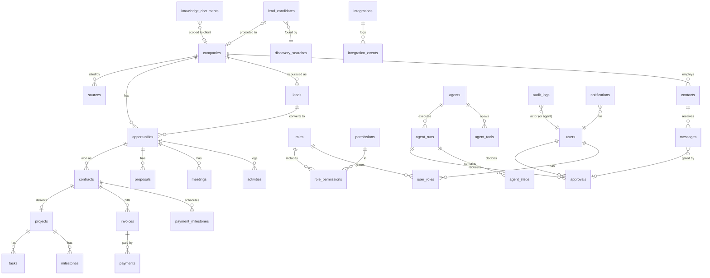

# 05 — Database Schema (design only; no migrations created)

PostgreSQL (Supabase). All tables live in schema **`app`**, which is **not** in the Data API's exposed schemas. RLS is enabled on every table anyway (defence in depth; doc 06).

Conventions:
- Primary keys are `uuid` with `default gen_random_uuid()`.
- Every table has `created_at timestamptz default now()` and `updated_at` (trigger).
- Soft delete uses `deleted_at` where history matters.
- Money is stored as `numeric(14,2)` + `currency char(3)`; amounts are never stored as floats.

## 1. Entity relationship diagram

## 2. Tables

### Identity and access

| Table | Key columns | Notes |
|---|---|---|
| `users` | `id` (= `auth.users.id`), `email` (unique), `display_name`, `status` (`active`/`disabled`), `mfa_required` bool default true, `last_seen_at` | A profile row per Supabase Auth user. Invite-only |
| `roles` | `id`, `key` (`owner`, `team_member`), `description` | Seeded |
| `permissions` | `id`, `key` (e.g. `crm.read`, `crm.write`, `finance.read`, `finance.write`, `approvals.decide.low`, `approvals.decide.high`, `agents.run`, `agents.manage`, `settings.manage`, `export.data`) | Seeded |
| `role_permissions` | `role_id`, `permission_id` (PK both) | |
| `user_roles` | `user_id`, `role_id` (PK both) | |
| `agent_identities` | `agent_id` FK, `service_key` (`agent:<key>`) | The actor identity in the audit log. Agents never authenticate as users |

### CRM

| Table | Key columns | Indexes / constraints |
|---|---|---|
| `companies` | `name`, `legal_name`, `tax_id`, `domain_normalized`, `website`, `industry`, `segment` enum(`developer`,`construction`,`real_estate`,`solar_installer`,`solar_om`,`enterprise`,`smb`,`partner`,`other`), `country` char(2), `city`, `size_band`, `status` enum(`prospect`,`client`,`partner`,`do_not_contact`,`archived`), `owner_user_id`, `notes` | UNIQUE (`domain_normalized`) WHERE not null; UNIQUE (`country`,`tax_id`) WHERE not null; trigram index on `name` (pg_trgm) for fuzzy dedupe; index (`segment`,`city`) |
| `contacts` | `company_id` FK, `full_name`, `role_title`, `email_normalized`, `phone_e164`, `linkedin_url`, `language_pref`, `lawful_basis` enum, `opt_out_at`, `source_id` FK | UNIQUE (`email_normalized`) WHERE not null; UNIQUE (`phone_e164`) WHERE not null; index `company_id` |
| `sources` | `entity_type`, `entity_id`, `url`, `title`, `accessed_at`, `excerpt` (≤ 1 KB), `captured_by` (user/agent), `confidence` enum(`high`,`medium`,`low`), `injection_suspected` bool | index (`entity_type`,`entity_id`) |
| `discovery_searches` | `brief` jsonb (industry, country, city, type, size, value, problem, opportunity), `status`, `agent_run_id`, `requested_by` | |
| `lead_candidates` | `search_id` FK, `company_snapshot` jsonb, `domain_normalized`, `research` jsonb, `score_total` int, `score_breakdown` jsonb, `est_deal_value` numeric + `currency`, `suggested_offer`, `confidence`, `status` enum(`pending_review`,`approved`,`rejected`,`duplicate`), `duplicate_of_company_id`, `reviewed_by`, `reviewed_at`, `approval_id` | index (`status`,`created_at`); index `domain_normalized` |
| `leads` | `company_id` FK, `primary_contact_id`, `stage` enum (the 14 stages, doc 02), `score_total`, `score_breakdown`, `suggested_offer`, `est_deal_value`, `currency`, `next_action`, `next_action_at`, `owner_user_id`, `lost_reason`, `source_channel` | index (`stage`,`next_action_at`); index `owner_user_id` |
| `opportunities` | `lead_id` FK, `company_id` FK, `offer` enum(`developer_sales_os`,`solar_ops_os`,`enterprise_automation`,`smb`,`brokerage`), `value_setup`, `value_monthly`, `currency`, `probability` numeric(4,3), `expected_close_on`, `stage` (mirrors lead stage from Proposal prepared onward) | index (`stage`,`expected_close_on`) |
| `activities` | `type` enum(`call`,`meeting`,`email`,`dm`,`note`,`task_done`,`stage_change`), `company_id`, `lead_id`, `opportunity_id`, `actor` (user or agent), `occurred_at`, `summary`, `outcome`, `metadata` jsonb | index (`company_id`,`occurred_at desc`) |
| `meetings` | `opportunity_id`, `scheduled_at`, `duration_min`, `location_or_link`, `status` (`scheduled`,`completed`,`no_show`,`cancelled`), `notes`, `brief_doc_id` | index `scheduled_at` |
| `messages` | `contact_id`, `channel` enum(`email`,`instagram`,`whatsapp`,`telegram`,`linkedin`,`phone_script`), `language`, `subject`, `body`, `facts_used` jsonb (source ids), `status` enum(`draft`,`pending_approval`,`approved`,`sent`,`discarded`), `approval_id`, `sent_at`, `sent_by`, `response_status` (`none`,`replied`,`bounced`,`opted_out`) | index (`status`,`created_at`) |
| `proposals` | `opportunity_id`, `version`, `doc_storage_path`, `pricing` jsonb, `payment_terms` jsonb, `status` (`draft`,`approved`,`sent`,`accepted`,`declined`,`expired`), `valid_until`, `approval_id` | UNIQUE (`opportunity_id`,`version`) |
| `contracts` | `opportunity_id`, `company_id`, `type` (`msa`,`sow`,`pilot`,`maintenance`,`nda`,`referral`), `value_total`, `currency`, `signed_on`, `signed_by_client`, `storage_path`, `status` | index `company_id` |

### Finance

| Table | Key columns | Notes |
|---|---|---|
| `fx_rates` | `on_date`, `base`, `quote`, `rate`, `source` | UNIQUE (`on_date`,`base`,`quote`) |
| `payment_milestones` | `contract_id`, `label` (deposit, go-live…), `amount`, `currency`, `due_on`, `status` (`planned`,`invoiced`,`paid`,`overdue`,`cancelled`) | |
| `invoices` | `contract_id`, `number` (unique), `amount`, `currency`, `issued_on`, `due_on`, `status` (`draft`,`issued`,`partially_paid`,`paid`,`void`) | |
| `payments` | `invoice_id` (nullable for unmatched receipts), `amount`, `currency`, `fx_rate_to_usd`, `amount_usd`, `fx_rate_to_amd`, `amount_amd`, `received_on`, `method`, `bank_reference`, `recorded_by`, `verified` bool | **The only source for "cash collected."** CHECK `amount > 0` |
| `costs` | `category` (`infrastructure`,`ai`,`software`,`ads`,`contractor`,`other`), `project_id` nullable, `amount`, `currency`, `amount_usd`, `incurred_on`, `vendor`, `recurring` bool | |
| `targets` | `name` ("40-day cash"), `metric` (`cash_received_usd`), `amount`, `starts_on`, `ends_on` | Drives the tracker |

### Delivery and operations

| Table | Key columns |
|---|---|
| `projects` | `company_id`, `contract_id`, `template` (enum of 4 products), `scope`, `status` (`planned`,`active`,`blocked`,`done`,`cancelled`), `start_on`, `due_on`, `tech_status`, `risks` jsonb, `owner_user_id` |
| `milestones` | `project_id`, `name`, `due_on`, `status`, `client_approval_required` bool, `client_approved_at` |
| `tasks` | `title`, `description`, `type` (`todo`,`follow_up`,`agent_task`,`recommendation`), `assignee_user_id` or `assignee_agent_id`, `due_at`, `priority` (1–4), `status`, `related_entity_type`, `related_entity_id`, `created_by` | index (`assignee_user_id`,`status`,`due_at`) |
| `notifications` | `user_id`, `kind`, `title`, `body`, `link`, `read_at`, `delivered_telegram_at` |

### Agents and approvals

| Table | Key columns | Notes |
|---|---|---|
| `agents` | `key` unique, `name`, `description`, `purpose`, `version`, `definition_hash`, `provider`, `model`, `effort`, `enabled` bool, `timeout_seconds`, `max_steps`, `max_cost_usd_per_run`, `monthly_cost_cap_usd`, `knowledge_scopes` text[] | Writable by owner only |
| `agent_tools` | `agent_id`, `tool_key`, `config` jsonb (e.g. domain allow-list) | Writable by owner only |
| `agent_runs` | `agent_id`, `agent_version`, `status` enum(`queued`,`running`,`waiting_approval`,`succeeded`,`failed`,`cancelled`,`timed_out`,`budget_exceeded`), `input` jsonb, `output` jsonb, `summary`, `error`, `requested_by`, `parent_run_id` (retries), `trace_id` uuid, `lease_owner`, `lease_expires_at`, `heartbeat_at`, `cancel_requested` bool, `started_at`, `finished_at`, `tokens_in`, `tokens_out`, `cost_usd`, `client_scope_company_id` | index (`status`,`created_at`); partial index on `status in ('queued','running')` |
| `agent_steps` | `run_id`, `seq`, `kind` (`model_call`,`tool_call`,`tool_result`,`note`), `tool_key`, `input` jsonb (redacted), `output_excerpt` text (≤ 8 KB, redacted), `tokens_in`, `tokens_out`, `cost_usd`, `duration_ms`, `error` | UNIQUE (`run_id`,`seq`) |
| `approvals` | `action_type`, `risk_level`, `requested_by_agent_id`, `requested_by_user_id`, `run_id`, `target` jsonb, `payload` jsonb, `payload_hash` (sha256), `reason`, `expected_result`, `status` enum(`pending`,`approved`,`rejected`,`expired`,`executed`,`failed`), `decided_by`, `decided_at`, `decision_note`, `decision_aal`, `expires_at`, `executed_at`, `execution_result` jsonb, `idempotency_key` unique, `trace_id` | index (`status`,`created_at`). Trigger: `status` transitions are allowed only via the executor role; `payload` is immutable once created |

### Knowledge and integrations

| Table | Key columns |
|---|---|
| `knowledge_documents` | `title`, `kind` (`company_profile`,`brand`,`product`,`pricing`,`script`,`proposal`,`technical`,`requirements`,`research`,`sop`,`approved_claims`), `classification` (`public`,`internal`,`confidential`,`client`), `client_company_id` (required when `classification='client'`), `body_md`, `storage_path`, `tsv` tsvector, `version`, `owner_user_id` |
| `integrations` | `key` (`telegram`,`google_sheets`,`gmail`,`n8n`,`anthropic`,…), `status`, `scopes` text[], `config` jsonb (**no secrets**), `last_success_at`, `last_error`, `last_error_at` |
| `integration_events` | `integration_id`, `direction`, `status`, `summary`, `trace_id` |
| `audit_logs` | `id` bigserial, `at`, `actor_type` (`user`,`agent`,`system`), `actor_id`, `action`, `resource_type`, `resource_id`, `result` (`success`,`denied`,`error`), `approval_id`, `trace_id`, `ip_hash`, `user_agent_hash`, `diff` jsonb (redacted) |

Notes on `audit_logs`:
- It is append-only: no UPDATE or DELETE grants for any app role.
- It is partitioned by month once it exceeds ~1M rows (not needed at MVP).

## 3. Data ownership rules

- **Business data** (CRM, finance, projects) is owned by RISEUP and edited by humans. Agents may write only to `lead_candidates`, `sources`, `messages` (draft status), `proposals` (draft), `tasks` (type recommendation) and their own `agent_runs`/`agent_steps`. Every other change goes through an approval or a human UI action.
- **Client-scoped knowledge** is readable only by runs whose `client_scope_company_id` matches, and by humans.
- **Finance** is readable by `owner` only unless `finance.read` is granted.

## 4. Retention assumptions (confirm with a lawyer; Phase 1 doc 16)

| Data | Retention |
|---|---|
| Prospects with no engagement | 12 months, then anonymise. Opt-outs are kept as a hashed suppression list |
| Clients, contracts, invoices, payments | ≥ 5 years (tax). **NEEDS VALIDATION** under Armenian tax law |
| `agent_steps` tool outputs | 90 days (summaries and outputs kept longer) |
| `audit_logs` | 2 years |
| Supabase Auth logs | Per Supabase plan |

## 5. RLS and exposure

- The `app` schema is not exposed in Supabase API settings. The browser never receives a DB-capable key for this schema.
- Server-side access uses a dedicated Postgres role `app_server` (not `service_role`) with grants per table. A second role, `app_agent_worker`, has narrower grants (doc 06 §4). The **`service_role` key is not used by the application** at all.
- RLS policies are still written: deny by default, plus policies keyed on `current_setting('app.user_id')` / `app.role`, set per transaction by the DAL. This protects against a future accidental exposure. `SECURITY DEFINER` functions are avoided; any that are needed get `set search_path = ''` and an explicit permission check.
- Supabase Security Advisor lints run in CI (e.g. "RLS disabled in public", "security definer view").

## 6. Backup and recovery

- Supabase Pro daily backups (retention per plan; **NEEDS VALIDATION**: 7 days on Pro). PITR is a paid add-on and not needed initially.
- A weekly `pg_dump` of `app` (encrypted) to private storage outside the Supabase project, kept for 4 weeks.
- Monthly restore drill into the staging project, with a checklist recorded in `docs/`.
- Targets: RPO ≤ 24 h, RTO ≤ 4 h (acceptable for a two-person company).
- Migrations: forward-only, reviewed SQL, applied to staging first. A destructive change (DROP or type narrowing) requires an owner approval and a fresh backup.

## Sources (accessed 2026-11-15)
- https://supabase.com/docs/guides/database/postgres/row-level-security
- https://supabase.com/docs/guides/auth/auth-mfa
- Security-definer and RLS pitfalls (secondary): https://makerkit.dev/blog/tutorials/supabase-rls-best-practices
- Supabase pricing (secondary; verify at supabase.com/pricing): https://www.activepieces.com/blog/supabase-pricing-free-tier-limits-pro-costs-egress
