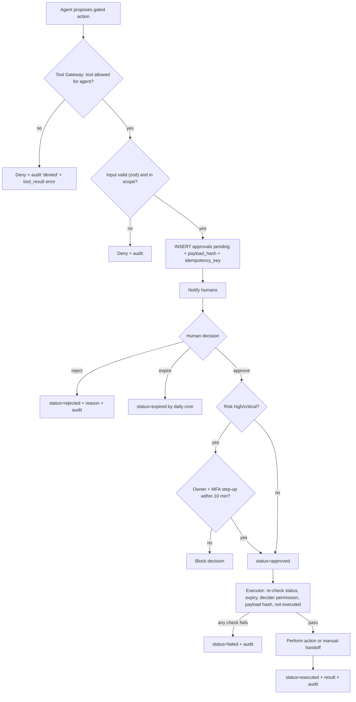
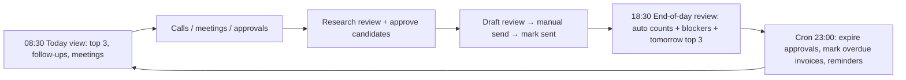
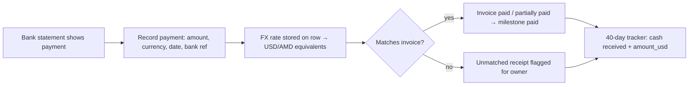

# 11 — Workflow Diagrams

All data shown in diagrams is illustrative. In production, every step writes real rows. Nothing is simulated.

## 1. End-to-end: Find Clients → cash → delivery (the 20 steps)

```mermaid
sequenceDiagram
    autonumber
    actor U as Founder / Team member
    participant UI as Command Center UI
    participant DAL as DAL (authz + audit)
    participant Q as agent_runs queue
    participant W as Agent worker
    participant R as Market Research agent
    participant L as Lead Qualification agent
    participant S as Sales Strategist (Phase D)
    participant O as Outreach agent
    participant P as Proposal agent (Phase D)
    participant A as Approvals + Executor
    participant F as Finance
    participant PM as Projects / Tasks

    U->>UI: Open Find Clients
    U->>UI: Brief (industry, location, size, problem)
    UI->>DAL: enqueueRun(market_research, brief) [cost estimate shown]
    DAL->>Q: insert run (queued, trace_id)
    W->>Q: claim lease
    W->>R: run loop (web_search / web_fetch, max_uses, caps)
    R-->>W: candidates + source URLs (schema-validated)
    W->>DAL: insert lead_candidates (pending_review) + sources
    W->>Q: enqueue lead_qualification(candidates)
    W->>L: score + est. value + suggested offer
    L-->>DAL: update scores (breakdown stored)
    U->>UI: Review candidates (sources, duplicates)
    U->>DAL: Approve selected → add_lead_to_crm approvals (decided by user)
    DAL->>A: execute → companies/contacts/leads created (stage: Qualified)
    U->>S: (Phase D) request approach brief; MVP: founder decides
    U->>O: Draft message for lead X (hy/ru/en)
    O-->>DAL: messages(draft, facts_used) → approval pending (send_email…)
    U->>A: Review exact recipient/channel/body → Approve (aal2)
    A-->>UI: "Approved for manual send" + copy/open channel
    U->>U: Human sends message outside the system
    U->>DAL: Mark as sent → activity logged, stage: Contacted
    DAL->>PM: follow-up task (+3 days) created
    U->>DAL: Log reply / meeting scheduled → completed (notes)
    U->>P: (Phase D) Proposal draft; MVP: template + founder
    P-->>A: send_proposal approval (owner, step-up)
    U->>A: Approve → proposal sent manually → stage: Proposal sent
    U->>DAL: Stage Won only with contract record or owner confirmation
    U->>F: Record payment (bank ref, currency, FX)
    F-->>DAL: cash_received updated (contract value unaffected)
    DAL->>PM: Project from template + delivery tasks
    UI-->>U: Overview reflects real rows only
```

## 2. Agent run state machine (with error handling)

```mermaid
stateDiagram-v2
    [*] --> queued: enqueue (authz ok, agent enabled, budget available)
    queued --> running: worker claims lease
    running --> running: step ok (checkpoint, heartbeat)
    running --> waiting_approval: gated tool requested
    waiting_approval --> running: approval decided (agent continues with result)
    waiting_approval --> succeeded: run ends after requesting approval
    running --> succeeded: final output passes schema
    running --> failed: 3 consecutive step errors / output schema invalid after 1 repair attempt
    running --> timed_out: wall clock > timeout_seconds
    running --> budget_exceeded: cost/token cap hit
    running --> cancelled: cancel_requested checked between steps
    running --> queued: lease expired (worker crash) → re-claim (max 2 times)
    failed --> [*]
    timed_out --> [*]
    budget_exceeded --> [*]
    cancelled --> [*]
    succeeded --> [*]
    note right of failed: Retry = new run with parent_run_id (manual; auto once for read-only timed_out)
```

**Error and retry rules:**
- **Model call:** the SDK retries 429 / 5xx / connection errors (default 2, exponential backoff). After that, the step fails.
- **Tool call:** an error is returned to the model as `is_error`. The model may try another approach. Repeated failures count toward the 3-consecutive limit.
- **Structured output invalid:** one repair prompt is allowed, then the run fails with the validation errors shown.
- **Worker crash:** the lease expires after 5 min and the run is re-claimed. Steps are idempotent by `(run_id, seq)`.
- **Notifications:** every terminal failure creates a notification, and a Telegram alert is sent after a streak of 3.

## 3. Approval enforcement



## 4. Daily operations loop



## 5. Payment recording (cash truth)


